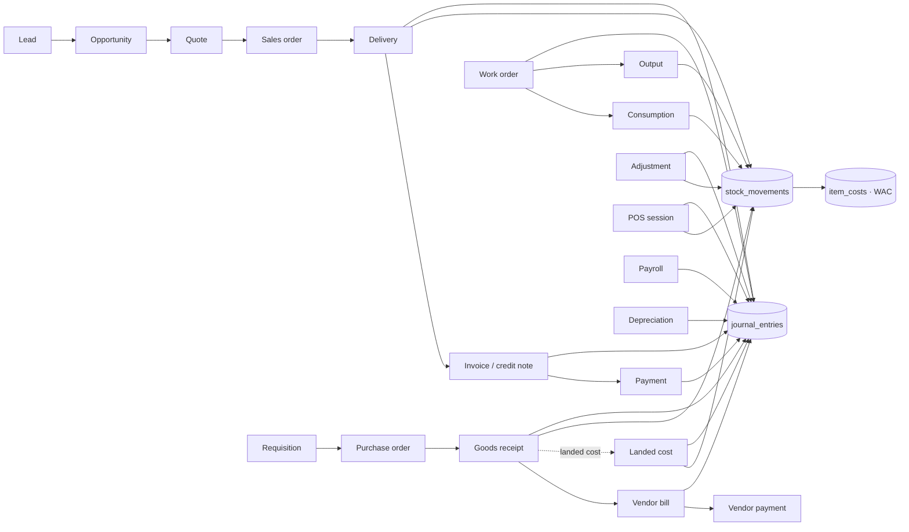

# NexusERP Pro — Database Schema (Phase 1)

PostgreSQL 15+ on Supabase · 135 tables · 461 RLS policies · 13 migrations · 81 passing schema tests

---

## 1. Design principles

| Principle | How it is enforced |
|---|---|
| **Tenant isolation** | Every business row carries `company_id`. RLS filters every table by the companies in which the caller holds the right permission. Children reference parents with **composite foreign keys** `(company_id, x_id) → parent(company_id, id)`, so a row can never point at another company's data — even a buggy server function can't cross tenants. |
| **Permission-based RLS** | Policies check `<module>.<action>` permissions (e.g. `inventory.write`), not role names. Roles are bundles of permissions, so a new role never needs a policy change. |
| **One convention for every table** | `app.register_table()` adds audit columns, `UNIQUE(company_id, id)`, triggers and policies. No table is hand-wired inconsistently. A migration-time check fails the deploy if any public table lacks RLS. |
| **Ledgers are append-only** | `stock_movements`, `item_cost_history`, `audit_log`, `approval_actions`, `pos_payments`, `z_reports` reject UPDATE/DELETE. Posted journal entries and their lines are frozen; corrections are reversals. |
| **Projections are system-owned** | `stock_levels`, `item_costs`, `stock_reservations`, `landed_cost_allocations` are readable by clients but writable only by `SECURITY DEFINER` posting functions. |
| **Soft deletes everywhere** | A client `DELETE` is converted into `deleted_at/deleted_by` by trigger. Deleted rows disappear for normal users but stay visible to holders of `audit.read` (admins, auditors) and can be restored with `restore_record()`. |
| **Full audit** | Row-level trigger logs INSERT / UPDATE / SOFT_DELETE / RESTORE with old row, new row, changed fields, actor and transaction id. |

---

## 2. Domains and tables

### Core & tenancy (`0100`, `0110`)
| Table | Purpose |
|---|---|
| `companies` | The tenant. NIPT/NUI tax number, NRB, country (AL/XK), base currency, timezone. |
| `profiles` | 1:1 with `auth.users`. Locale (en/sq), theme, `last_company_id` (company switcher), `is_super_admin` (platform flag, not client-writable). |
| `company_members` | User ↔ company membership (`invited` / `active` / `suspended`). Invites by email are accepted automatically on signup. |
| `member_roles` | Roles a member holds in a company (many per member). |
| `roles`, `role_permissions`, `permissions` | 14 system roles mapped to permission patterns (`finance.*`, `*.read`, `*`). |
| `company_settings` | Negative-stock policy, costing method, 3-way-match tolerances, default tax codes / warehouse, fiscalization codes. |
| `currencies`, `exchange_rates` | ISO currencies; per-company dated rates (`app.exchange_rate()` resolves latest on or before a date). |
| `document_types`, `status_transitions` | Every document type: number prefix, owning module, approval statuses, and its allowed status graph. |
| `document_sequences`, `document_sequence_counters` | Per-company numbering config + per-year counters. Gapless (row-lock, rolls back with the transaction). |
| `approval_workflows`, `approval_workflow_steps`, `approval_requests`, `approval_actions` | Configurable multi-step approvals by amount threshold, approver role or user, N-of-M per step. |
| `entity_activities` | Timeline per record: comments, calls, status changes (auto), approval decisions (auto). |
| `attachments` | File metadata; objects live in Storage at `<company_id>/…`. |
| `notifications` | Per-user inbox (clients may only flip `read_at`). |
| `data_table_views` | Saved columns/filters/sort for the advanced data table, private or shared. |
| `audit_log` | Append-only change log. |

### Master data (`0200`)
`accounts` (CoA, type/subtype, group vs postable, normal balance, cash-flow category) · `cost_centers` · `fiscal_years`, `fiscal_periods` (no overlaps — exclusion constraints; open/closed/locked) · `payment_terms` · `tax_codes` (rate, exemption, reverse charge, VAT accounts) · `units_of_measure` (category + ratio) · `price_lists`, `price_list_items` (qty breaks, validity) · `business_partners` (customer and/or vendor, credit limit, AR/AP account overrides) · `partner_contacts` · `partner_addresses` · `warehouses` · `warehouse_locations` (hierarchical bins + virtual supplier/customer/adjustment/scrap/transit/production locations) · `product_categories` (GL account overrides) · `products` (template) · `product_attributes`, `product_attribute_values` · `product_variants` (the SKU — **every transactional line references a variant**) · `variant_attribute_values` · `product_barcodes` (EAN/UPC/Code128/QR, carton qty multiplier) · `vendor_products` (vendor price, MOQ, lead time, preferred vendor).

### Inventory, WMS, OMS (`0300`)
| Table | Notes |
|---|---|
| `stock_movements` | **The stock ledger.** Every change is a move from one location to another with quantity, unit cost, source document & line, and its journal entry. Immutable. |
| `stock_levels` | Projection per variant × location × lot: `on_hand`, `reserved`, **`available = on_hand − reserved`** (generated). |
| `item_costs` | Weighted-average-cost state per variant: `avg_cost`, `qty_on_hand`, `total_value`. |
| `item_cost_history` | Every WAC recalculation (before/after, qty in, cost in). |
| `stock_reservations` | Soft allocations from sales orders / work orders. |
| `lots` | Lot / serial with manufacture and expiry dates. |
| `stock_adjustments` (+lines) | Signed quantity changes with reason; approval-capable. |
| `stock_transfers` (+lines) | Inter-warehouse, via transit location. |
| `cycle_counts` (+lines) | Blind counts; `variance` generated; posting creates an adjustment. |
| `warehouse_tasks` (+lines) | Putaway / pick / pack / move / replenish / count, assignable. |
| `replenishment_rules`, `replenishment_suggestions` | Min/max per variant × warehouse; buy / manufacture / transfer; converts to PO or WO. |

### CRM & Sales (`0400`)
`crm_pipeline_stages` → `leads` → `opportunities` (weighted value generated) → `sales_quotes` (+lines) → `sales_orders` (+lines: qty reserved/delivered/invoiced) → `deliveries` (+lines with COGS unit cost) → `sales_invoices` (+lines; invoice **or** credit note, own number series, `amount_due` generated, fiscal status).

### Procurement (`0500`)
`purchase_requisitions` (+lines) → `purchase_orders` (+lines: qty received/billed) → `goods_receipts` (+lines: lot, location, unit cost, landed cost, QC) → `vendor_bills` (+lines linked to PO line **and** receipt line for three-way match; duplicate vendor-invoice numbers blocked) · `landed_costs` with `landed_cost_receipts`, `landed_cost_charges`, `landed_cost_allocations` (by value/qty/weight/volume).

### Manufacturing (`0600`)
`work_centers` (labor + overhead rates) · `boms` (one default per product, versioned) · `bom_operations` · `bom_lines` (multi-level; **cycle detection trigger**) · `work_orders` (parent/child WOs, material/labor/overhead cost, generated total and unit cost) · `work_order_materials` · `work_order_operations` · `work_order_consumptions` · `production_outputs` · `lot_genealogy` (input lots → output lots, forward/backward trace).

### Finance (`0700`)
`journals` · `company_account_defaults` (posting rules: receivable, payable, inventory, GRNI, COGS, VAT in/out, WIP, payroll, depreciation…) · `journal_entries` (source document link, reversal links, period resolved automatically) · `journal_lines` (base-currency debit/credit + foreign amount, partner, cost center, tax code, variant) · `bank_accounts` · `bank_statements` (+lines, matching) · `payments` (customer receipts / vendor payments) · `payment_allocations` (to invoices or bills) · `fixed_asset_categories` · `fixed_assets` (book value generated) · `asset_depreciation_lines`.

GL integrity, enforced in the database:
- posted entry must have ≥ 2 lines and **Σdebit = Σcredit > 0** (deferred constraint trigger, checked at commit)
- each line is exactly one-sided (`(debit = 0) <> (credit = 0)`)
- only active, postable (leaf) accounts
- entry date must be in an **open** fiscal period
- posted entries and lines are frozen; one live automatic entry per source document

Reports (P&L, Balance Sheet, Cash Flow, T-accounts, aging) are built on these tables in Phase 5.

### HR & Payroll (`0800`)
`departments` · `job_positions` · `employees` (optional login link) · `employment_contracts` (one active) · `attendance_records` (hours generated) · `leave_types` · `leave_requests` · `payroll_runs` (AL or XK rules) · `payslips` · `payslip_lines`.

### POS (`0900`)
`pos_registers` (AL TCR code / XK device serial) · `pos_sessions` (one open per register; cash difference generated) · `pos_orders` (**`UNIQUE(company_id, client_uuid)`** for idempotent offline sync) · `pos_order_lines` (**tax-inclusive** pricing: net and VAT derived from gross) · `pos_payments` · `pos_cash_movements` · `z_reports` (immutable).

### Logistics & e-commerce (`1000`)
`carriers` · `vehicles` · `delivery_routes` · `shipments` (incl. cash-on-delivery) · `route_stops` · `sales_channels` (secrets referenced in Vault, never stored) · `channel_product_links` · `channel_orders` (idempotent by external id) · `channel_sync_logs`.

### Tax & fiscal (`1100`)
`vat_declarations` (no overlapping periods) · `fiscal_tcrs` · `fiscalization_records` (AL IIC/NSLF, FIC/NIVF, QR URL; XK verification code; request/response payloads; retry state) · views **`v_sales_book`** and **`v_purchase_book`** (per VAT rate, base currency, credit notes negative, `security_invoker` so RLS applies).

---

## 3. Document flow and traceability



Every arrow is a foreign key. Every posting document stores `journal_entry_id`; every journal entry stores `source_doc_type` + `source_doc_id`; every stock movement stores `source_doc_type`, `source_doc_id` and `source_line_id`.

Status graphs (validated by trigger on every insert/update, logged to the timeline):

| Document | Allowed flow |
|---|---|
| Sales order | draft → (pending_approval →) confirmed → partially_delivered → delivered → closed; cancel from draft/pending/confirmed |
| Purchase order | draft → (pending_approval →) approved → sent → partially_received → received → closed |
| Invoice / bill | draft → posted (cancel only from draft; corrections by credit note) |
| Journal entry | draft → posted → reversed |
| Work order | draft → released → in_progress → completed → closed |
| Stock adjustment | draft → (pending_approval →) approved → posted |
| …and 25 more | see `20261023000110_reference_data.sql` |

---

## 4. RLS strategy

### Helper functions (schema `app`, not exposed by the API)
| Function | Returns |
|---|---|
| `app.my_company_ids()` | companies where the caller is an active member (all for super admin) |
| `app.company_ids_with('module.action')` | companies where the caller holds that permission (matches `module.action`, `module.*`, `*.action`, `*`) |
| `app.has_permission(company, perm)` / `app.require_permission(...)` | boolean / raise — used inside RPCs |
| `app.my_employee_ids()` | employee records linked to the caller (self-service) |

All are `SECURITY DEFINER`, `search_path = ''`, `STABLE`. Policies wrap them as `(select app.fn())::uuid[]` so Postgres evaluates them **once per statement** (InitPlan) instead of once per row.

### Standard policies generated per table
```sql
-- SELECT
company_id = any ((select app.company_ids_with('<read_module>.read'))::uuid[])
  and (deleted_at is null or company_id = any ((select app.company_ids_with('audit.read'))::uuid[]))
-- INSERT / UPDATE
company_id = any ((select app.company_ids_with('<module>.write'))::uuid[])
-- DELETE (becomes soft delete)
company_id = any ((select app.company_ids_with('<module>.delete'))::uuid[])
```
Tables flagged `client_write = false` get only the SELECT policy. Immutable tables get no UPDATE/DELETE policy.

### Special cases
- **companies**: members read; `admin.write` updates; creation only via `create_company()`.
- **profiles**: read self + co-members; update self only, column-limited (cannot touch `is_super_admin`).
- **notifications / data_table_views**: owner-only.
- **Employee self-service** (additional permissive policies): own employee record, own attendance, own leave (create / withdraw, never approve), own payslips only once the run is posted.
- **Storage**: object path must start with a company id the caller belongs to; upload requires `collab.write` (attachments) or `inventory.write`/`admin.write` (company assets).
- **anon** has no table privileges at all.

### Role → permission matrix (summary)
| Role | Write | Read-only extras |
|---|---|---|
| Company Admin / Super Admin | everything | — |
| Finance Manager | finance, tax, invoicing, partners | most modules, payroll, audit log |
| Accountant | finance, tax, invoicing, partners | sales, procurement, inventory, POS |
| Sales Manager | crm, sales, invoicing, partners | inventory, WMS, logistics, POS |
| Sales Rep | crm, sales, partners | invoicing, inventory, WMS |
| Inventory Manager | inventory, WMS, OMS, requisitions | procurement, manufacturing, sales |
| Warehouse Operator | WMS | inventory, logistics, sales, procurement |
| Procurement Manager | procurement, requisitions, OMS, partners | invoicing, inventory, WMS |
| Production Manager | manufacturing, inventory, WMS, requisitions | procurement, sales |
| HR Manager | hr, payroll | — |
| POS Cashier | pos, partners | inventory |
| Employee | comments/attachments | self-service only |
| Auditor | — | everything (`*.read`) incl. audit log and deleted rows |

---

## 5. RPCs available to the client (Phase 1)
| Function | Purpose |
|---|---|
| `create_company(name, country, currency?, tax_number?, legal_name?)` | Creates tenant, settings, admin membership, and seeds UoMs, AL/XK VAT codes, payment terms, warehouse + locations, fiscal year with 12 periods, pipeline stages, leave types. |
| `invite_member(company, email, role_keys[])` | Adds an existing user or a pending invite. |
| `switch_company(company)` | Persists the active company. |
| `get_my_context()` | Companies, roles and effective permissions for the logged-in user (boots the app). |
| `submit_for_approval(doc_type, id)` / `decide_approval(request, decision, comment)` | Approval engine (segregation of duties: no self-approval). |
| `restore_record(table, id)` | Undo a soft delete (needs `<module>.delete`). |

---

## 6. What lands in later phases (schema is ready, logic is not yet written)
- ~~Phase 2~~ done: `post_goods_receipt`, `post_stock_adjustment`, `post_stock_transfer`, `post_landed_cost`, reservations, low-stock alerts — see `INVENTORY.md`.
- Phase 3–4: pricing, quote→order→delivery→invoice conversion, three-way match engine.
- Phase 5: automatic GL posting engine (uses `company_account_defaults`), AR/AP aging, financial statements, default chart of accounts per country.
- Phase 6–8: POS sync + session close + Z-report, production costing, payroll engines (AL/XK), fiscalization Edge Function.
